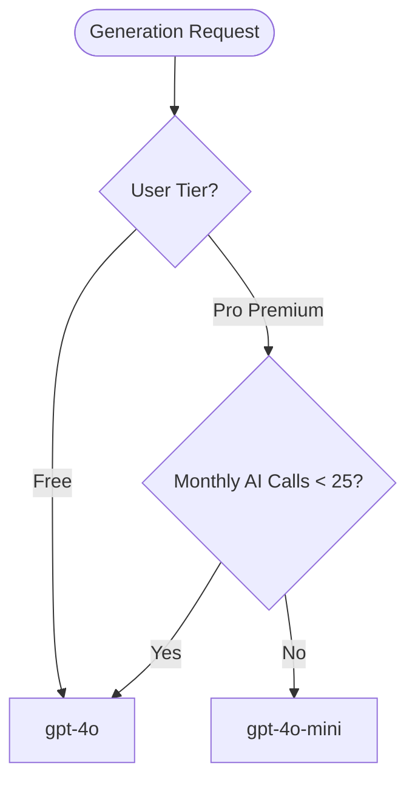

# AI Banter Prompting Playbook

This playbook documents how the PadelRoast AI engine generates comedic match commentary, routing strategies, model configurations, and prompting structures.

---

## 1. Model Routing & Pricing Strategy

We use different models dynamically based on user subscription tiers and monthly usage to maintain high quality while controlling API costs:



- **`gpt-4o` (Premium Quality):** Configured for all Free users (up to 3/month) to optimize the conversion funnel, and for paying Pro users' first 25 calls of the month.
- **`gpt-4o-mini` (Cost-Efficient):** Actively throttled for Pro users exceeding 25 calls in a month. This ensures they have unlimited usage without scaling costs unsustainably.

---

## 2. Parameter Configurations

- **JSON Format Enforced:** The API request explicitly enables structured output formats:
  ```json
  "response_format": { "type": "json_object" }
  ```
- **Dynamic Temperature:**
  - Standard Tones (`casual`, `balanced`, `savage`): **`1.0`** (ensures good structural compliance and flow).
  - Unhinged Tone (`savage!!`): **`1.2`** (higher temperature unlocks extreme comedic variance and aggressive, over-the-top burns).

---

## 3. Prompting Architecture

Both system and user prompts are assembled dynamically in [generate-roast/index.ts](file:///c:/Users/dsalv/Projects/padel-app/supabase/functions/generate-roast/index.ts).

### 3.1 System Prompt Structure
The system prompt contains the app's identity, rules (e.g. referencing scores/names, emoji usage, copy-paste format), localization parameters, and tone-specific directives:

- **Casual:** friendly banter, light teasing.
- **Balanced:** sports-reporter humor, clever remarks.
- **Savage:** biting insults, career-demolishing jokes.
- **Savage!!:** unhinged commentary, dramatic ESPN-style host on a rampage.

### 3.2 User Prompt Structure
Conveys the match details:
- **Teams & Scores:** Team A vs Team B set scores.
- **Detected Trigger:** Deterministic evaluation of set margins (e.g. *Dominant* for a bagel, *Comeback* if down a set).
- **History Context:** Past 5 encounters of the same 4 players.
- **Target Schema:** Enforces the exact JSON response mapping containing 3 cards with headlines, body text, pre-filled WhatsApp messages, match recaps, MVP lines, and rematch taunts.

---

## 4. Testing Prompt Modifications Locally

When adjusting prompts:
1. Make updates to `buildSystemPrompt` or `buildUserPrompt` in [index.ts](file:///c:/Users/dsalv/Projects/padel-app/supabase/functions/generate-roast/index.ts).
2. Serve the function locally using `supabase functions serve generate-roast --no-verify-jwt`.
3. Verify that:
   - The response remains a parseable JSON object.
   - The response includes exactly 3 alternative card objects in `roast_cards`.
   - The model respects the localization language parameter.
   - The output is creative and matches the requested tone.
