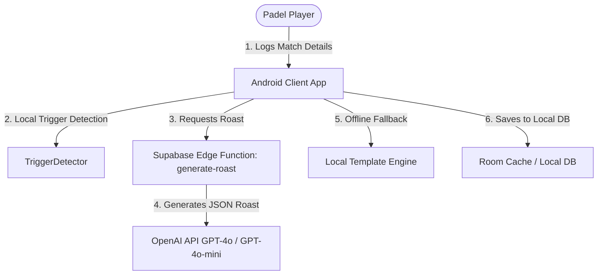

# PadelRoast Architecture Overview

This document provides a high-level overview of the PadelRoast application architecture, detailing how components interact to log matches, detect game triggers, generate AI roasts, and cache results.

---

## 1. High-Level Component Flow

The system operates in a **hybrid content mode**:
1. **Online Flow:** The client requests a roast from the Supabase Edge Function, which calls OpenAI's GPT models to return a structured JSON payload containing 3 alternative roast cards.
2. **Offline Flow:** If the server is unreachable or the user's monthly free generation quota is exhausted, the client falls back to generating a roast locally using deterministic templates.

---

## 2. Android Client Architecture (MVVM)

The Android application is built using modern MVVM practices and Kotlin:

- **UI Layer (Compose):** Interactive views and cards. It binds to StateFlow fields in the ViewModel.
- **ViewModel Layer ([BanterViewModel](file:///c:/Users/dsalv/Projects/padel-app/app/src/main/java/com/example/ui/BanterViewModel.kt)):** 
  - Manages player inputs, score sheets, selected tones, and generation states.
  - Queries local rivalry history to inject into prompts via `getRivalryHistoryContext`.
  - Determines whether to call the remote Supabase API or trigger the offline `TemplateEngine` local fallback based on [UserTier](file:///c:/Users/dsalv/Projects/padel-app/app/src/main/java/com/example/data/UserTier.kt) statistics.
- **Repository / Data Layer (Room database + Retrofit):**
  - Logs match scores and local Elo calculations.
  - Caches the JSON responses.

### Data Schema & Naming Discrepancy Note

> [!NOTE]
> In the local database schemas and references in the codebase (e.g., [BanterViewModel.kt:L154](file:///c:/Users/dsalv/Projects/padel-app/app/src/main/java/com/example/ui/BanterViewModel.kt#L154)), you will see fields like `gemini_response_json`. This is a legacy naming artifact from when the project initially targeted Gemini models. The database column is retained for compatibility, but the cached JSON payload is generated by the OpenAI API.

---

## 3. Remote AI Generation & Edge Functions

- **Supabase Edge Function:** Served via Deno at `/functions/generate-roast`. 
- **OpenAI Integration:** The Edge Function parses request payloads containing player arrays, scores, detected triggers, tags, and previous history context. It then requests a JSON-formatted response from `https://api.openai.com/v1/chat/completions`.
- **Structured Outputs:** By enforcing OpenAI's JSON mode (`response_format: { type: "json_object" }`), we guarantee that the output JSON strictly matches the client-side parsing schema ([RoastResponseSchema](file:///c:/Users/dsalv/Projects/padel-app/app/src/main/java/com/example/ui/BanterViewModel.kt#L153)).

---

## 4. Offline Template Fallback Engine

When the client is offline or has run out of monthly generations, the local `TemplateEngine` takes over:
- It uses the detected deterministic match trigger (e.g., *Comeback, Bagel, Close*) combined with the selected tone to load predefined, localized format templates.
- It interpolates player names, scores, and mock stats dynamically.
- This ensures that the user's workflow is never blocked by network failures or tier limits, maintaining a seamless user experience.
