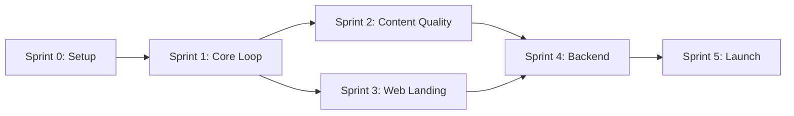

# PadelRoast — Sprint Plan

> Derived from [PRD.md](./PRD.md) v1.2 · Total timeline: **~8 weeks**
>
> 📱 iOS publishing details: [IOS_PUBLISHING_GUIDE.md](./IOS_PUBLISHING_GUIDE.md)

---

## Overview

| Sprint | Name | Duration | Goal |
|--------|------|----------|------|
| 0 | **Foundation & Setup** | Week 0 (3–4 days) | Dev environment, project scaffolding, CI/CD |
| 1 | **Core Loop — Local MVP** | Weeks 1–2 | Log match → Generate card → Share (local-only) |
| 2 | **Content Quality & Polish** | Weeks 3–4 | AI engine hardening, card design, UX polish |
| 3 | **Web Landing & Viral Loop** | Week 5 | Next.js spectator mode, deep links, install funnel |
| 4 | **Backend & Persistence** | Week 6 | Firebase integration, ghost profiles, claim system |
| 5 | **Monetization & Launch Prep** | Weeks 7–8 | Premium tier, store submission, analytics |

---

## Sprint 0 — Foundation & Setup

> **Duration:** 3–4 days · **Goal:** Everything needed before writing product code
>
> ⚠️ **Start Apple Developer enrollment on Day 1** — approval takes 24–48 hours

### 0.1 Apple Developer Enrollment ⬅️ DO THIS FIRST

> Full walkthrough: [IOS_PUBLISHING_GUIDE.md → Phase 1](./IOS_PUBLISHING_GUIDE.md#phase-1-prerequisites-do-this-now)

- [ ] Ensure your iPad runs iPadOS 16+ (for Apple Developer app)
- [ ] Create Apple ID (if you don't have one) with **2FA enabled**
- [ ] Download **Apple Developer** app on iPad
- [ ] Enroll in Apple Developer Program ($99/year, Individual)
- [ ] Scan government-issued photo ID via the app
- [ ] Pay and submit — wait 24–48 hours for approval

### 0.2 Apple Developer Setup (After Approval)

> Full walkthrough: [IOS_PUBLISHING_GUIDE.md → Phase 2](./IOS_PUBLISHING_GUIDE.md#phase-2-set-up-app-store-connect-week-12)

- [ ] Register Bundle ID: `com.padelroast.app`
  - Enable capabilities: Push Notifications, Associated Domains, In-App Purchase
- [ ] Create app in App Store Connect (name: PadelRoast, SKU: `padelroast-ios`)
- [ ] Generate **App Store Connect API Key** (`.p8` file)
  - Store Key ID and Issuer ID securely
  - ⚠️ `.p8` file can only be downloaded **once**

### 0.3 Google Play Setup

- [ ] Create app in Google Play Console (you already have an account)
- [ ] Set up app listing (draft — metadata can come later)
- [ ] Generate upload key / keystore for app signing
- [ ] Note: Google Play requires a **closed testing track** with 12+ testers for 14 days before production release

### 0.4 Flutter Project Setup

- [ ] Install Flutter SDK (stable channel)
- [ ] Create Flutter project (`flutter create padel_roast`)
- [ ] Configure `pubspec.yaml` with initial dependencies:
  - `hive` + `hive_flutter` — local storage
  - `share_plus` — native sharing
  - `screenshot` or `repaintboundary` — widget-to-image export
  - `google_fonts` — typography
  - `flutter_riverpod` or `provider` — state management
  - `go_router` — navigation
- [ ] Set up folder structure:
  ```
  lib/
  ├── core/           # constants, theme, utils
  ├── features/
  │   ├── match/      # match input flow
  │   ├── card/       # roast card rendering + export
  │   ├── share/      # sharing logic
  │   └── player/     # player management
  ├── models/         # data models
  ├── services/       # AI service, storage service
  └── main.dart
  ```
- [ ] Configure app icon and splash screen
- [ ] Platform-specific config:
  - **Android:** `build.gradle` — set `applicationId: com.padelroast.app`, minSdk, signing config
  - **iOS:** `Info.plist` — set bundle identifier, sharing permissions, photo library usage descriptions
  - **iOS:** `Runner.xcodeproj` — set deployment target (iOS 16+)

### 0.5 Brand & Design System

- [ ] Define color palette (dark-first, bold accent colors)
- [ ] Set up typography scale (heading, body, roast text)
- [ ] Create `ThemeData` with brand tokens
- [ ] Design Roast Card template in Figma or directly in Flutter
  - 1080×1080 (feed)
  - 1080×1920 (stories)
- [ ] Create app icon and branding assets
  - 1024×1024px (App Store — no alpha, no rounded corners)
  - Adaptive icon for Android

### 0.6 Next.js Project Setup

- [ ] Create Next.js project (`npx -y create-next-app@latest ./web`)
- [ ] Configure for static export + dynamic routes
- [ ] Set up deployment target (Vercel)
- [ ] Add placeholder landing page with brand identity

### 0.7 CI/CD Pipeline Setup

#### Codemagic (iOS + Android builds)

> Full walkthrough: [IOS_PUBLISHING_GUIDE.md → Phase 3](./IOS_PUBLISHING_GUIDE.md#phase-3-set-up-codemagic-cicd-sprint-0)

- [ ] Sign up at [codemagic.io](https://codemagic.io) (free tier — 500 min/month)
- [ ] Connect GitHub repository
- [ ] Configure iOS code signing (automatic):
  - Upload `.p8` API key
  - Enter Key ID + Issuer ID
  - Codemagic auto-generates certificates + provisioning profiles
- [ ] Configure Android signing:
  - Upload keystore file
  - Set signing credentials
- [ ] Create `codemagic.yaml` in project root (see [IOS_PUBLISHING_GUIDE.md](./IOS_PUBLISHING_GUIDE.md#33-codemagicyaml-configuration) for template)
- [ ] **Trigger first test build** to verify both platforms compile
- [ ] Confirm iOS build uploads to TestFlight
- [ ] Confirm Android build generates `.aab`

#### Vercel (Web)

- [ ] Connect Next.js repo to Vercel
- [ ] Verify auto-deploy on push

### 0.8 Development Tooling

- [ ] Initialize Git repository with `.gitignore` for Flutter + Next.js
- [ ] Set up linting:
  - Flutter: `analysis_options.yaml` with strict rules
  - Next.js: ESLint + Prettier
- [ ] Create `.env` template for API keys (AI provider)
- [ ] Set up Firebase project (even if not used until Sprint 4):
  - Create project in Firebase console
  - Reserve Firestore, Hosting, Dynamic Links
  - Download `google-services.json` (Android)
  - Download `GoogleService-Info.plist` (iOS)
  - Add both to `.gitignore` and Codemagic environment

### 0.9 AI Provider Setup

- [ ] Choose AI provider (Gemini / OpenAI / Anthropic)
- [ ] Create API account + generate keys
- [ ] Test basic prompt → response roundtrip
- [ ] Define prompt template structure for roast generation
- [ ] Set up cost monitoring / usage alerts

### Sprint 0 — Exit Criteria

- [ ] Apple Developer account approved and configured
- [ ] Bundle ID registered + App Store Connect API key generated
- [ ] Google Play Console app created (draft)
- [ ] Codemagic builds both iOS and Android successfully
- [ ] iOS test build accessible via TestFlight
- [ ] Flutter app runs on Android emulator (local dev)
- [ ] Next.js site deploys to Vercel with placeholder page
- [ ] Git repo has clean structure with CI passing
- [ ] AI API responds to test prompts
- [ ] Design tokens and card template defined

---

## Sprint 1 — Core Loop (Local MVP)

> **Duration:** 2 weeks · **Goal:** `LOG MATCH → GENERATE → SHARE` in ≤15 seconds

### 1.1 Match Input Screen (Week 1)

- [ ] Build match input screen:
  - Player name fields (2v2)
  - Tap-based score input (set 1, set 2, optional set 3)
  - Optional context chips ("comeback", "choke", "blowout")
- [ ] Implement player name auto-suggest (from Hive local storage)
- [ ] Build "Same Again" button — pre-fills last match's players
- [ ] Enforce speed constraints:
  - No blocking modals
  - No required fields beyond names + score
  - Autofocus on first input

### 1.2 Local Storage Layer (Week 1)

- [ ] Define data models:
  ```dart
  class Player { String name; List<String> matchIds; }
  class Match { List<Player> teams; List<SetScore> score; DateTime date; String? context; }
  class RoastOutput { String text; String tone; String trigger; DateTime generated; }
  ```
- [ ] Initialize Hive boxes: `players`, `matches`, `roastHistory`
- [ ] Implement CRUD operations:
  - Save/load players
  - Save/load matches
  - Track recent roast outputs (for anti-repetition)

### 1.3 AI Content Engine v1 (Week 1–2)

- [ ] Implement deterministic trigger detection:
  - `upset` — lower-ranked team wins
  - `blowout` — 6-0, 6-1 type scores
  - `close_match` — tiebreaks, 7-5 sets
  - `comeback` — lost first set, won match
- [ ] Build prompt template:
  ```
  Generate a roast card for a padel match.
  Winners: {names}. Losers: {names}. Score: {score}.
  Trigger: {trigger}. Tone: {tone}.
  Rules: Be funny, specific to the score, under 30 words.
  ```
- [ ] Implement AI service with:
  - Primary model call
  - Fallback to stronger model on low-quality response
  - Basic retry logic
- [ ] Generate 1 primary + 1–2 alternative roasts per request
- [ ] Implement basic anti-repetition:
  - Store last 20 outputs in Hive
  - Append "Avoid these structures: ..." to prompt

### 1.4 Roast Card Rendering (Week 2)

- [ ] Build `RoastCard` widget:
  - Player names (winners highlighted)
  - Score display
  - Roast text (bold, centered)
  - Branding footer (PadelRoast logo + link)
- [ ] Support two formats:
  - 1080×1080 (square — WhatsApp, feed)
  - 1080×1920 (vertical — Instagram Stories)
- [ ] Implement widget → image export (`RepaintBoundary` → `toImage` → PNG)
- [ ] Build swipeable card carousel (primary + alternatives)

### 1.5 Share Flow (Week 2)

- [ ] Implement native share:
  - Share image to WhatsApp (primary)
  - Share to Instagram Stories
  - Save image to gallery
  - Copy link (placeholder URL for now)
- [ ] Build share bottom sheet with clear CTAs
- [ ] Implement first-time nudge:
  - Show once: *"This is what your group will see — drop it in WhatsApp 👇"*
  - Track shown state in Hive

### 1.6 Tone Selector (Week 2)

- [ ] Build tone toggle UI (Casual / Balanced / Savage)
- [ ] Default to "Balanced"
- [ ] Pass tone to AI prompt
- [ ] Persist user preference in Hive

### 1.7 Cross-Platform Verification (Week 2)

- [ ] Push build to Codemagic → verify iOS build succeeds
- [ ] Install iOS build via TestFlight on iPad/iPhone
- [ ] Verify share flow works on iOS (WhatsApp, Instagram, Save to Photos)
- [ ] Test on Android emulator (local) or physical device
- [ ] Fix any platform-specific rendering issues (card export, fonts, etc.)

### Sprint 1 — Exit Criteria

- [ ] Full flow works offline: input match → see card → share image
- [ ] AI generates varied, tone-appropriate roasts
- [ ] Card renders cleanly at both aspect ratios
- [ ] Share works to WhatsApp and Instagram on **both iOS and Android**
- [ ] iOS build installs and runs via TestFlight
- [ ] Player names auto-suggest on subsequent uses
- [ ] ⏱️ Full flow completes in ≤15 seconds

---

## Sprint 2 — Content Quality & UX Polish

> **Duration:** 2 weeks · **Goal:** Make the content genuinely funny and the UX delightful

### 2.1 AI Engine Hardening (Week 3)

- [ ] Expand prompt library:
  - 20–30+ variation templates per trigger × tone
  - Different structures: roast, commentary, headline, award
- [ ] Implement quality gate:
  - If response is generic/repetitive → auto-regenerate once
  - If still weak → fallback to high-tier model
- [ ] Add anti-repetition v2:
  - Track structural patterns (not just exact text)
  - Vary punchline positioning
  - Rotate vocabulary pools
- [ ] Implement "Regenerate" button for user-triggered refresh

### 2.2 Titles System (Week 3)

- [ ] Define title catalog:
  - 👑 *King Slayer* — beat the top-ranked player
  - 📊 *Stat Padder* — plays most matches
  - 👻 *The Ghost* — rarely shows up
  - 🔥 *On Fire* — 3+ win streak
  - 💀 *The Choker* — leads then loses
- [ ] Build title assignment engine (deterministic rules)
- [ ] Display active title on Roast Card
- [ ] Pass titles to AI prompt for personalized content

### 2.3 Card Design Polish (Week 3–4)

- [ ] Design 3–4 card themes/styles:
  - Default (dark, bold)
  - Neon
  - Minimal
  - Fire/Savage
- [ ] Add subtle animations to card preview (optional: confetti on blowout)
- [ ] Ensure branding is visible but not overbearing
- [ ] Add QR code or short URL to card for viral loop

### 2.4 UX Polish (Week 4)

- [ ] Add haptic feedback on tap interactions
- [ ] Smooth transitions between input → loading → card reveal
- [ ] Card reveal animation (slide up, fade in)
- [ ] Empty states and onboarding hints
- [ ] Error handling:
  - AI timeout → show loading with retry
  - No internet → queue for later (stretch)
- [ ] Match history screen (local — list of past matches + cards)

### 2.5 Testing & QA (Week 4)

- [ ] **Android testing:**
  - Test on multiple screen sizes (emulator + physical if available)
  - Verify share flow (WhatsApp, Instagram, Telegram)
  - Check card rendering at both aspect ratios
- [ ] **iOS testing (via TestFlight):**
  - Push build via Codemagic → install on iPad/iPhone
  - Verify share flow (WhatsApp, Instagram, save to camera roll)
  - Test on both iPhone and iPad layouts
  - Check iOS-specific behaviors (haptics, keyboard, status bar)
- [ ] Test edge cases (both platforms):
  - Very long player names
  - Unusual scores (retired, walkover)
  - Rapid successive matches
- [ ] Performance profiling: ensure ≤15 second flow
- [ ] AI response quality audit (50+ generated cards reviewed)

### Sprint 2 — Exit Criteria

- [ ] Card quality consistently high across all triggers/tones
- [ ] Titles display correctly and rotate based on history
- [ ] Multiple card themes available
- [ ] UX feels polished, fast, and satisfying
- [ ] No critical bugs on **iOS (tested via TestFlight) or Android**

---

## Sprint 3 — Web Landing & Viral Loop

> **Duration:** 1 week · **Goal:** Turn every shared card into an install opportunity

### 3.1 Next.js Landing Page (Week 5)

- [ ] Design and build marketing landing page:
  - Hero section with example Roast Card
  - "How it works" (3 steps)
  - App store badges (placeholder initially)
  - Social proof / example cards carousel
- [ ] SEO setup:
  - Title tags, meta descriptions
  - Open Graph / Twitter Card meta for shared links
  - Schema markup
- [ ] Mobile-first responsive design

### 3.2 Spectator Mode (Week 5)

- [ ] Build dynamic route: `/match/[id]`
- [ ] Display:
  - Roast Card image
  - Match context
  - Player names
- [ ] No login required
- [ ] CTA buttons:
  - *"Claim your stats"* → app store link
  - *"That you? See your record"* → app store link
- [ ] Share meta tags (so link previews show the card image)

### 3.3 Deep Linking Setup (Week 5)

- [ ] Configure Firebase Dynamic Links (or custom deep link solution)
- [ ] Flow:
  1. Card shared with `padelroast.com/match/[id]`
  2. Opens spectator mode on web
  3. CTA → opens app (if installed) or store (if not)
- [ ] Add deep link URL to every generated Roast Card
- [ ] Generate unique match ID for every shared card

### 3.4 Analytics Foundation (Week 5)

- [ ] Integrate basic analytics:
  - Page views on spectator mode
  - CTA click-through rate
  - Share events from app
- [ ] Track:
  - Shares per match
  - Spectator → install conversion
  - Card views per share

### 3.5 App Store & Play Store Linking (Week 5)

- [ ] **iOS:** Add App Store listing URL to landing page CTAs
  - If app not yet reviewed: use TestFlight public link as placeholder
- [ ] **Android:** Add Google Play listing URL to landing page CTAs
- [ ] Smart banner: detect platform and show correct store badge
- [ ] Deep links route to correct store:
  - iOS device → App Store / TestFlight
  - Android device → Play Store
  - Desktop → landing page

### Sprint 3 — Exit Criteria

- [ ] Landing page live on `padelroast.com`
- [ ] Spectator mode renders shared cards with CTA
- [ ] Deep links work end-to-end (share → web → app/store) on **both platforms**
- [ ] Store badges link to correct destination per platform
- [ ] Analytics tracking active on all key events

---

## Sprint 4 — Backend & Persistence

> **Duration:** 1 week · **Goal:** Cloud storage, ghost profiles, claim system

### 4.1 Firebase Integration (Week 6)

- [ ] Initialize Firebase in Flutter app
- [ ] Set up Firestore collections:
  ```
  users/
  players/              # includes ghost profiles
  matches/
  roasts/               # generated card data
  circles/              # P1: group continuity
  ```
- [ ] Define Firestore security rules
- [ ] Implement data sync:
  - On share → upload match + roast to Firestore
  - On app open → sync local Hive ↔ Firestore
  - Offline-first: Hive is primary, Firestore is backup

### 4.2 Authentication (Week 6)

- [ ] Implement lightweight auth:
  - Anonymous auth (default — no friction)
  - **Google Sign-In** (Android + iOS)
  - **Apple Sign-In** (iOS — required by Apple if you offer any social login)
- [ ] Configure Sign-In providers:
  - **Google:** Firebase Console → enable Google provider, add SHA-1 (Android) and OAuth client ID (iOS)
  - **Apple:** Enable in Apple Developer → Certificates → Service IDs; configure in Firebase
- [ ] Auth guards:
  - Match logging: no auth required
  - Profile/claim: anonymous auth minimum
  - Premium: full auth required

### 4.3 Ghost Profiles (Week 6)

- [ ] On match log:
  - Check if player name exists in `players/`
  - If not → create ghost profile (name-only, `isGhost: true`)
  - If yes → link to existing player
- [ ] Ghost profile stores:
  - Name
  - Match history (list of match IDs)
  - Titles
  - `claimedBy: null`

### 4.4 Claim System (Week 6)

- [ ] Build claim flow in app:
  1. User opens shared link → spectator mode
  2. Taps "Claim your stats"
  3. App opens → shows list of ghost profiles matching context
  4. User selects: *"I am [Name]"*
  5. Ghost profile merged → `claimedBy: userId`, `isGhost: false`
- [ ] Merge transfers:
  - Match history
  - Titles
  - Stats
- [ ] Handle ambiguity:
  - Multiple players with same name → show match context to disambiguate

### 4.5 Match Upload & Card Hosting (Week 6)

- [ ] On share → upload:
  - Match data to Firestore
  - Card image to Firebase Storage
  - Generate permanent URL for spectator mode
- [ ] Update Next.js spectator mode to fetch from Firestore
- [ ] Cache card images via CDN

### Sprint 4 — Exit Criteria

- [ ] Matches persist across app reinstalls
- [ ] Ghost profiles created automatically on match log
- [ ] Claim flow works end-to-end
- [ ] Spectator mode loads real match data from Firestore
- [ ] Offline-first sync works reliably

---

## Sprint 5 — Monetization & Launch Prep

> **Duration:** 2 weeks · **Goal:** Revenue model active, stores submitted, ready to ship
>
> 📱 iOS submission details: [IOS_PUBLISHING_GUIDE.md → Phase 4–5](./IOS_PUBLISHING_GUIDE.md#phase-4-prepare-store-listing-sprint-5)

### 5.1 Monetization (Week 7)

- [ ] Implement free tier limits:
  - X cards per month (e.g., 10)
  - Track usage in Firestore
  - Show limit indicator in UI
- [ ] Implement premium tier:
  - Unlimited cards
  - Premium card themes
  - AI priority (always use high-tier model)
- [ ] Integrate payment:
  - `in_app_purchase` or `purchases_flutter` (RevenueCat) — Flutter
  - **iOS:** Create In-App Purchase in App Store Connect (subscription or consumable)
  - **iOS:** Configure StoreKit in App Store Connect → In-App Purchases section
  - **iOS:** Test with Sandbox Apple ID
  - **Android:** Create in-app product in Google Play Console → Monetize
  - **Android:** Test with license tester accounts
  - Restore purchases flow (both platforms)
- [ ] Build paywall screen:
  - Show when free limit hit
  - Highlight premium benefits
  - Free trial option (optional)

### 5.2 Post-Match Engagement (Week 7)

- [ ] On app open — show engagement widget:
  - 📈 Ranking changes since last session
  - 🔥 Active streaks
  - 🏅 New titles earned
- [ ] Light notification strategy (optional):
  - *"[Name] just logged a match — check the results"*
  - Only for claimed users, not ghosts

### 5.3 Circles — Group Continuity — P1 (Week 7)

- [ ] Auto-detect recurring player groups
- [ ] Create `circles/` collection:
  - Players list
  - Match history
  - Group stats / leaderboard
- [ ] Show circle context on match input:
  - *"Match #14 in this circle"*
  - *"[Name] leads 8–6"*

### 5.4 Store Assets Preparation (Week 8)

- [ ] **Privacy policy** — publish at `padelroast.com/privacy`
  - Data collected, third-party services, retention, contact info
  - Account deletion mechanism (required by both stores if accounts exist)
- [ ] **App icon** — 1024×1024px PNG, no alpha channel
- [ ] **App description & keywords** — written and localized if needed

#### iOS Screenshots

> See [IOS_PUBLISHING_GUIDE.md → Screenshots](./IOS_PUBLISHING_GUIDE.md#42-screenshots) for full spec

- [ ] Generate screenshots at 6.9" iPhone size (1320×2868) — others auto-scale
- [ ] Minimum 3, recommended 5–8 per device class
- [ ] Design marketing frames (Figma / Canva / screenshots.pro)
- [ ] Capture actual app UI (match input, roast card, share flow, themes, tone selector)

#### Android Screenshots

- [ ] Generate screenshots for phone (1080×1920 minimum)
- [ ] Optional: 7" tablet, 10" tablet
- [ ] Feature graphic: 1024×500px
- [ ] Minimum 2, recommended 5–8

### 5.5 iOS App Store Submission (Week 8)

> Full walkthrough: [IOS_PUBLISHING_GUIDE.md → Phase 5](./IOS_PUBLISHING_GUIDE.md#phase-5-review--submission)

- [ ] **TestFlight final build:**
  - Push release build via Codemagic
  - Install on iPad via TestFlight
  - Full QA pass on real iOS device
  - Add up to 25 internal testers for last-round feedback
- [ ] **App Store Connect metadata:**
  - App name, subtitle (30 chars), description (4000 chars)
  - Keywords (100 chars): `padel, roast, banter, match, share, score, card`
  - Category: Sports (primary), Entertainment (secondary)
  - Support URL: padelroast.com
  - Privacy Policy URL: padelroast.com/privacy
  - Age rating: 12+ (infrequent mild humor)
- [ ] **App Privacy questionnaire:**
  - Declare data types collected (names, gameplay content, identifiers, diagnostics)
  - See [IOS_PUBLISHING_GUIDE.md → App Privacy](./IOS_PUBLISHING_GUIDE.md#45-app-privacy-questionnaire)
- [ ] **Upload screenshots** to App Store Connect
- [ ] **Select TestFlight build** for review
- [ ] **App Review notes:**
  - Explain AI-generated content
  - Provide test instructions (no login required for MVP)
  - Note: content is humorous, user-initiated, not harmful
- [ ] **Submit for review** (expect 24–48 hours)
- [ ] **Handle rejection** (if any) — see [common rejection reasons](./IOS_PUBLISHING_GUIDE.md#54-common-rejection-reasons-to-avoid)

### 5.6 Google Play Store Submission (Week 8)

- [ ] **Internal testing build:**
  - Build release `.aab` via Codemagic
  - Upload to internal testing track
  - Test on physical device or share with testers
- [ ] **Closed testing (required before production):**
  - Add 12+ testers to closed testing track
  - Run for **14 days minimum** (Google Play requirement)
  - ⚠️ Start this early — ideally during Sprint 4/5 transition
- [ ] **Google Play Console metadata:**
  - App name, short description (80 chars), full description (4000 chars)
  - Category: Sports
  - Content rating questionnaire
  - Target audience and content declarations
  - Privacy Policy URL: padelroast.com/privacy
  - Data safety section (similar to Apple's App Privacy)
- [ ] **Upload screenshots + feature graphic**
- [ ] **Promote to production** (after 14-day closed testing)
- [ ] **Review** (typically 1–3 days for first submission)

### 5.7 Launch Readiness (Week 8)

- [ ] **Final QA pass — both platforms:**
  - iOS: full flow on real device via TestFlight
  - Android: full flow on real device or emulator
  - Payment flow test (iOS Sandbox + Android license tester)
  - Deep link flow test (share → web → correct store)
  - Edge cases and error states
- [ ] **Performance audit:**
  - App startup time (both platforms)
  - Match-to-share flow timer
  - AI response latency
- [ ] **Set up monitoring:**
  - Firebase Crashlytics (iOS + Android)
  - Performance monitoring
  - AI cost dashboard
- [ ] **Prepare launch materials:**
  - Landing page final copy with live store badges
  - Update store URLs on landing page + Roast Cards
  - Social media assets
  - Initial WhatsApp test group seeding plan

### Sprint 5 — Exit Criteria

- [ ] Free/Premium tiers functional with working payments on **both iOS and Android**
- [ ] In-app purchases tested in sandbox (iOS) and license testing (Android)
- [ ] Post-match engagement displays on app open
- [ ] Circles auto-detect and show group context
- [ ] ✅ App submitted to **App Store** (iOS)
- [ ] ✅ App submitted to **Google Play** (Android)
- [ ] Landing page live with correct store badges and links
- [ ] Crashlytics + analytics active in production on both platforms

---

## Post-Launch Backlog (P1+)

| Feature | Priority | Notes |
|---------|----------|-------|
| Push notifications | P1 | Match results for claimed users |
| Card reactions | P1 | Emoji reactions on spectator page |
| Head-to-head stats | P1 | Show rivalry stats on cards |
| PadelBanter.com SEO blog | P2 | Content marketing via secondary domain |
| Tournament mode | P2 | Multi-match events |
| Custom player avatars | P2 | Upload photo for card personalization |
| Leaderboard web page | P2 | Public circle leaderboards |
| API for integrations | P3 | Let communities embed widgets |
| Multi-language support | P3 | Spanish, Portuguese, Italian, French |

---

## Risk Register

| Risk | Impact | Mitigation |
|------|--------|------------|
| AI responses are repetitive/low quality | 🔴 High | Anti-repetition system + fallback model + prompt library |
| Share flow friction on iOS/Android | 🔴 High | Test via TestFlight (iOS) + real device (Android) from Sprint 1 |
| Apple App Store rejection | 🟡 Medium | Review [common reasons](./IOS_PUBLISHING_GUIDE.md#54-common-rejection-reasons-to-avoid), comply with AI content policy |
| Google Play 14-day testing gate | 🟡 Medium | Start closed testing early (Sprint 4) to avoid launch delays |
| iOS code signing issues | 🟡 Medium | Use Codemagic automatic signing — [setup guide](./IOS_PUBLISHING_GUIDE.md#32-setup-steps) |
| Low claim conversion (ghost → user) | 🟡 Medium | A/B test CTA copy, optimize spectator page |
| AI costs spike with usage | 🟡 Medium | Usage limits on free tier, model tiering, caching |
| Apple requires Sign in with Apple | 🟡 Medium | Implement Apple Sign-In whenever any social login is offered |
| Firebase Dynamic Links deprecated | 🟢 Low | Abstract deep link layer, easy to swap provider |

---

## Key Dependencies



> [!NOTE]
> **Sprints 2 and 3 can run in parallel** if there are two developers — one on Flutter (content quality) and one on Next.js (web landing).
